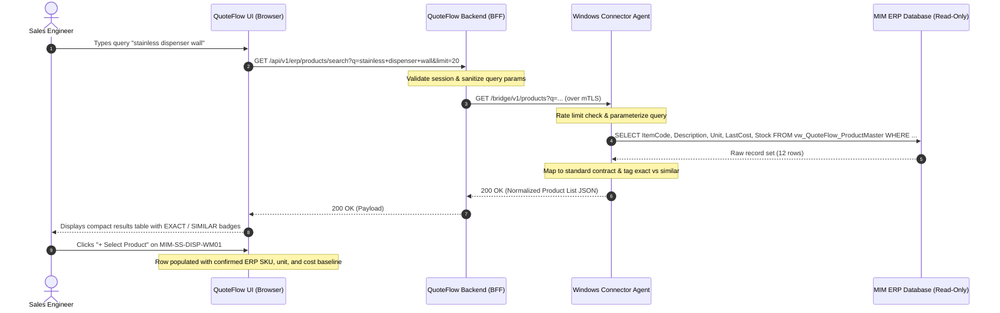
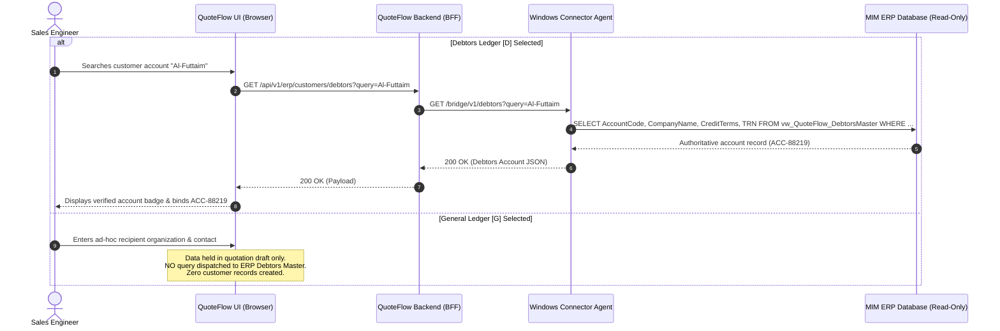
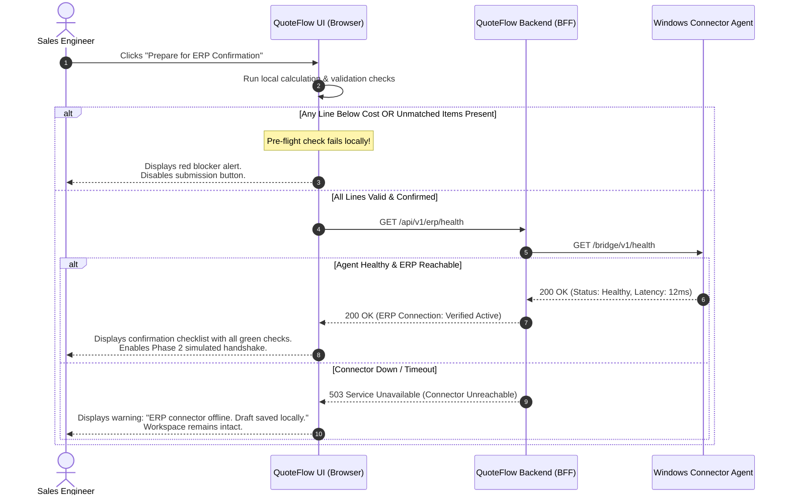

# MIM QuoteFlow AI — Phase 2: Read-Only ERP Connector Architecture

> **Document Version:** 1.0.0 (Phase 2 Specification)  
> **Status:** Architecture Reference & Specification  
> **Classification:** Strictly Read-Only  

---

## 1. System Overview & Architectural Principles

The **MIM QuoteFlow AI Read-Only ERP Connector** bridges the browser-based quotation workspace with the on-premise MIM Windows ERP system. 

```
                                SYSTEM BOUNDARY
 ┌──────────────────────────────────────────────────────────────────────────────┐
 │                                                                              │
 │   ┌────────────────────────┐                  ┌──────────────────────────┐   │
 │   │   Client Web Browser   │                  │  QuoteFlow Backend (BFF) │   │
 │   │  (QuoteFlow Prototype) │◄──HTTPS/REST────►│  Node.js / Express API   │   │
 │   │                        │ (Ephemeral State)│                          │   │
 │   └────────────────────────┘                  └─────────────┬────────────┘   │
 │                                                             │                │
 └─────────────────────────────────────────────────────────────┼────────────────┘
                                                               │ Internal LAN /
                                                               │ Mutual TLS 1.3
 ┌─────────────────────────────────────────────────────────────▼────────────────┐
 │                 SECURE ON-PREMISE WINDOWS SERVER ENVIRONMENT                 │
 │                                                                              │
 │   ┌────────────────────────────────┐       ┌─────────────────────────────┐   │
 │   │   QuoteFlow Windows Service    │       │     MIM Windows ERP Host    │   │
 │   │        (Bridge Agent)          │◄─────►│    (Desktop / App Server)   │   │
 │   │   - Strictly Read-Only Adapter │  IPC/ │                             │   │
 │   │   - Rate Limiting & Validation │  SQL  │  ┌───────────────────────┐  │   │
 │   │   - Zero Write Permissions     │       │  │ ERP Read-Only Views / │  │   │
 │   │                                │       │  │ Vendor Integration SDK│  │   │
 │   └────────────────────────────────┘       │  └───────────────────────┘  │   │
 │                                            └─────────────────────────────┘   │
 └──────────────────────────────────────────────────────────────────────────────┘
```

### Core Architecture Principles

1. **Zero Browser-to-Database Exposure:**
   The client browser **never** connects directly to the ERP database or API. All requests traverse an authenticated Backend-For-Frontend (BFF) and an on-premise Windows Connector Agent.
2. **Zero Credentials in Client Code:**
   No database connection strings, passwords, or service tokens are compiled into or accessible from frontend scripts.
3. **Strictly Read-Only Enforcement:**
   The Windows Connector Agent executes queries exclusively with database credentials configured with `SELECT` permissions on explicit, sanitized database views. No stored procedures that perform `INSERT`, `UPDATE`, `DELETE`, or table alterations are accessible.
4. **Decoupled Fallback & Draft Preservation:**
   If the on-premise ERP connector becomes unreachable or times out, QuoteFlow AI **fails closed** for ERP confirmation, but **preserves all local draft data** (lines, customer notes, overrides) without crashing or discarding user work.
5. **No Synthetic Data In Live Mode:**
   When live mode is enabled, QuoteFlow never displays mocked data as confirmed ERP data without explicit visual labeling.

---

## 2. Evaluation of Integration Options

Three integration approaches were evaluated for the MIM Windows ERP:

| Architectural Option | Pros | Cons | Recommendation |
| :--- | :--- | :--- | :--- |
| **Option A: Vendor-Supported ERP REST/SOAP API** | Supported by ERP vendor; updates cleanly with software patches; enforces vendor business logic. | Requires vendor API license; may not exist for older Windows desktop ERP installations. | **Top Preference** if confirmed during Discovery. |
| **Option B: Dedicated Windows Service Agent (Connector Bridge)** | Runs locally alongside Windows ERP; translates lightweight HTTPS/REST calls into local queries; handles connection pooling and rate limiting. | Requires deployment and service monitoring on internal Windows server. | **Selected Baseline Architecture** (Flexible for both Vendor SDK or SQL Views). |
| **Option C: Direct Database Query from Cloud/Web Server** | Fast to build initially; minimal intermediary code. | **Dangerous:** Exposes ERP SQL port to network; vendor support may be voided; risky credential handling; high latency over WAN. | **REJECTED.** Violates security and compliance boundaries. |

---

## 3. Component Details & Responsibilities

### 1. Client Browser (QuoteFlow AI UI)
- Renders the desktop-first quotation workspace, dashboard, pending drafts, catalogue search modal, and A4 printable preview.
- Dispatches asynchronous query requests to the QuoteFlow BFF endpoints:
  - `/api/v1/erp/products/search`
  - `/api/v1/erp/customers/debtors`
  - `/api/v1/erp/pricing/lookup`
  - `/api/v1/erp/health`
- Handles latency indicators, error toasts, and retry states cleanly.
- Manages local draft persistence in LocalStorage (`MIM_DRAFTS_STORE`).

### 2. QuoteFlow Backend (BFF - Backend for Frontend)
- Serves the static web assets and validates client session cookies / JWTs.
- Enforces user authorization (sales engineer vs. estimator vs. manager).
- Sanitizes query strings, enforces pagination boundaries (`limit <= 50`), and rate-limits client requests.
- Forwards validated requests across a secure TLS 1.3 tunnel to the on-premise Windows Connector Agent.
- Redacts sensitive operational telemetry from error responses returned to the client.

### 3. QuoteFlow Windows Service (Bridge Agent)
- A lightweight Windows background service (`QuoteFlowBridgeSvc.exe` or Node/C# daemon) installed on the internal network.
- Authenticates incoming requests from the BFF using mutual TLS (mTLS) and pre-shared rotating API tokens.
- Executes parameterized `SELECT` queries against designated, pre-compiled read-only views on the ERP database (or calls official vendor DLL assemblies).
- Normalizes raw ERP schemas into standard QuoteFlow JSON data contracts.
- Enforces strict request timeouts ($3000\text{ ms}$) to prevent connection exhaustion.
- Writes structured JSON security audit logs to Windows Event Log / local audit files.

### 4. MIM Windows ERP & Database
- Production ERP system managing product masters, customer accounts, and standard cost logs.
- Exposes read-only views created specifically for QuoteFlow (e.g., `vw_QuoteFlow_ProductMaster`, `vw_QuoteFlow_DebtorsMaster`).

---

## 4. Sequence Diagrams

### Sequence 1: Product Search & Confirmation Flow



### Sequence 2: Customer Search (Debtors Ledger vs General Ledger)



### Sequence 3: ERP Confirmation Pre-Flight Guard (Fail-Closed)



---

## 5. Network Boundaries, Latency & Resiliency

### 1. Network Topology
- **Browser to BFF:** Public internet / corporate VPN via standard HTTPS (Port 443) secured with TLS 1.3 certificates.
- **BFF to Windows Service Agent:** Dedicated HTTPS reverse proxy (e.g., Cloudflare Tunnel, AWS API Gateway, or internal enterprise firewall NAT) restricted to fixed originating IP addresses on Port 8443.
- **Windows Service Agent to ERP DB:** Localhost / internal private VLAN connection over standard database port (e.g. TCP 1433 for Microsoft SQL Server), never exposed to WAN.

### 2. Timeouts & Connection Limits
- **Client Request Timeout:** $4000\text{ ms}$. If no response is received, the UI displays a retry prompt without clearing draft state.
- **BFF to Bridge Agent Timeout:** $3000\text{ ms}$.
- **Bridge Agent to ERP Query Timeout:** $2500\text{ ms}$.
- **Max Concurrent ERP Connections:** Limited to 10 connections in the bridge connection pool to prevent resource contention with active ERP desktop clients.

### 3. Graceful Degradation & Fail-Closed Behavior
- If the ERP connector is offline, searches return a clear `"ERP Connector Offline"` notice.
- Existing quotation line items and draft data remain fully editable.
- The UI prevents advancing to ERP Confirmation when the connector is unavailable, enforcing strict data integrity.
