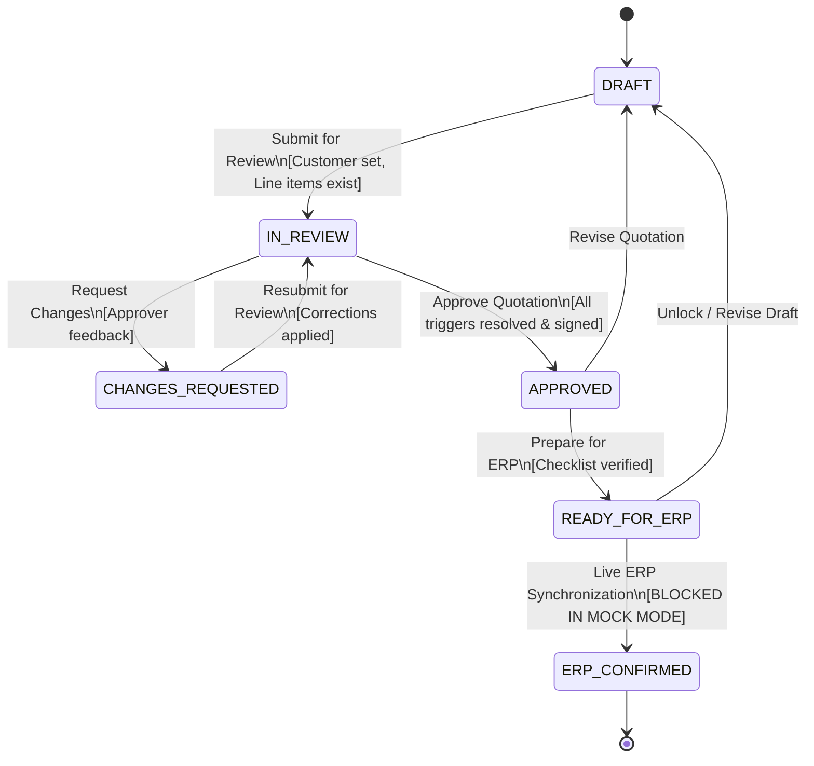
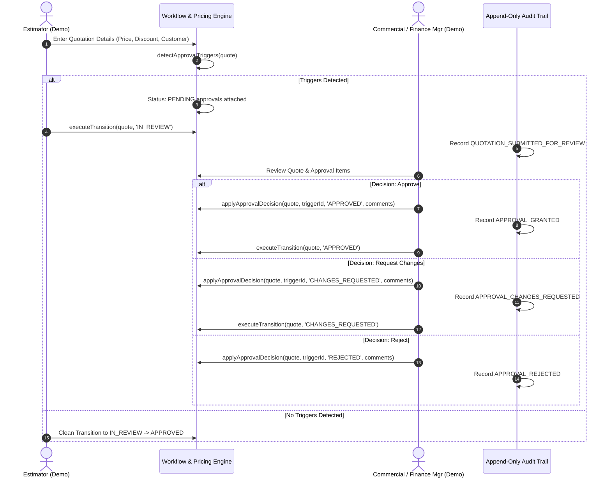

# MIM QuoteFlow AI — Phase 4 Specification & Architecture Report
## Business Rules & Workflow Hardening

**Document Reference:** `docs/phase-4/BUSINESS_RULES_AND_WORKFLOW.md`  
**Phase:** Phase 4 — Business Rules & Workflow Hardening  
**Repository:** `https://github.com/ATS-Volvi/MIM_QuoteDesk.git`  
**Branch:** `main`  
**Baseline Commit:** `5798a1d` (Phase 3.5: Mock-Connected Workspace Integration)  
**Date:** 2026-10-30  
**Security Boundary:** **STRICT MOCK DEMO MODE — READ-ONLY ADAPTER ENFORCED**

---

## 1. Executive Summary & Objectives

Phase 4 evolves the **MIM QuoteFlow AI** workspace from a mock-connected visual prototype into an enterprise-grade, rule-governed quotation management system.

While previous phases verified the read-only connector contract and user interaction loops, Phase 4 addresses business workflow correctness, commercial approvals, pricing policy centralization, append-only auditability, and professional quotation presentation:
1. **Explicit Quotation Lifecycle:** Centralized state machine with 6 discrete lifecycle states (`DRAFT`, `IN_REVIEW`, `CHANGES_REQUESTED`, `APPROVED`, `READY_FOR_ERP`, `ERP_CONFIRMED`). Frontend status mutations are strictly gated by transition validators.
2. **Mock-Mode Security Boundary:** Transition to `ERP_CONFIRMED` is strictly blocked and unreachable in mock mode (`ERR_ERP_CONFIRMATION_NOT_PERMITTED_IN_MOCK`), eliminating any possibility of false claims of ERP synchronization.
3. **Centralized Pricing Policy Configuration:** All commercial assumptions (provisional 5% UAE VAT, provisional WAC costing, 15% discount threshold, 15% minimum margin, AED currency, 2 decimal places) are extracted into [`src/rules/pricingPolicy.js`](file:///c:/Users/swast/OneDrive/Desktop/MIM_QuoteDesk/src/rules/pricingPolicy.js) without hardcoded fragmentation.
4. **Commercial Approval Framework:** Structured multi-trigger approval workflow supporting `Approve`, `Reject`, and `Request Changes` actions executed by explicitly labeled demo manager roles.
5. **Customer & Product Validation:** Strengthened Debtors Ledger account isolation vs. General Ledger recipient routing, credit-hold alerts, unmatched SKU guards, and missing cost quarantine.
6. **Append-Only Audit Trail:** In-memory append-only audit logger capturing all quotation lifecycle mutations, pricing adjustments, customer routing changes, and approval decisions.
7. **Professional Customer Quotation Preview:** Standardized print-ready A4 document featuring company headers, provisional tax notices, draft watermarks, itemized discount breakdown, and commercial terms.
8. **Automated Verification:** Dedicated 88-assertion test suite in [`tests/phase4_business_rules_test.js`](file:///c:/Users/swast/OneDrive/Desktop/MIM_QuoteDesk/tests/phase4_business_rules_test.js), executed alongside all 4 legacy test suites with a 100% pass rate.

---

## 2. Quotation Lifecycle Architecture

### 2.1 State Definitions

| State | Purpose | Permissions / Next Allowed States |
| :--- | :--- | :--- |
| `DRAFT` | Initial authoring phase where lines, quantities, and pricing are drafted. | May transition to `IN_REVIEW`. |
| `IN_REVIEW` | Formal review phase where pricing and margin policies are validated and approval triggers are evaluated. | May transition to `APPROVED` (if all approvals granted) or `CHANGES_REQUESTED` (if issues identified). |
| `CHANGES_REQUESTED` | Draft returned to estimator for corrections or repricing. | May transition back to `IN_REVIEW`. |
| `APPROVED` | All commercial and managerial sign-offs are granted. Quote locked from unapproved price changes. | May transition to `READY_FOR_ERP` or back to `DRAFT` (if amended). |
| `READY_FOR_ERP` | Staged and verified for export or synchronization with MIM Windows ERP. | May transition back to `DRAFT` if revised. |
| `ERP_CONFIRMED` | **RESERVED STATE.** Official ERP voucher recorded. | **BLOCKED IN MOCK MODE.** Throws `ERR_ERP_CONFIRMATION_NOT_PERMITTED_IN_MOCK`. |

### 2.2 Lifecycle State Machine Diagram



### 2.3 Central Transition Validator Rules Matrix

The function `validateTransition(quote, targetState, actor, options)` in [`src/rules/workflowLifecycle.js`](file:///c:/Users/swast/OneDrive/Desktop/MIM_QuoteDesk/src/rules/workflowLifecycle.js) enforces strict preconditions before any quotation state mutation:

```javascript
// Verification Rule Matrix
1. Valid State Transition:
   - Target state must be explicitly permitted from current state in VALID_TRANSITIONS.
2. Mock Security Boundary:
   - targetState === 'ERP_CONFIRMED' ALWAYS yields allowed: false with ERR_ERP_CONFIRMATION_NOT_PERMITTED_IN_MOCK.
3. Pre-flight Data Integrity:
   - targetState in ['IN_REVIEW', 'APPROVED', 'READY_FOR_ERP']:
     * Customer name must not be blank.
     * Line items count must be >= 1.
     * Unmatched items (erpCode === null) are strictly prohibited.
     * Items with unknown cost (costPrice === null) are strictly prohibited.
4. Commercial Approval Gate:
   - targetState === 'APPROVED':
     * Any unresolved approval trigger (status === 'PENDING' or 'REJECTED') blocks transition.
5. Readiness Gate:
   - targetState === 'READY_FOR_ERP':
     * Current state MUST be 'APPROVED'.
```

Direct UI state assignment is completely disabled. Every user interaction routes through `executeTransition(quote, targetState, actor, options)`, which validates the transition, mutates the state, records an append-only audit event, and returns a verified state object.

---

## 3. Centralized Pricing & Margin Policy

### 3.1 Policy Configuration Schema

All commercial rules reside in [`src/rules/pricingPolicy.js`](file:///c:/Users/swast/OneDrive/Desktop/MIM_QuoteDesk/src/rules/pricingPolicy.js). Hardcoded VAT percentages or margin thresholds across UI views are eliminated.

```javascript
export const DEFAULT_PRICING_POLICY = {
    currency: 'AED',
    decimalPrecision: 2,
    vatPercent: 5.0,              // Provisional UAE VAT
    vatIsProvisional: true,        // Clear disclaimer flag
    costValuationBasis: 'WAC',     // Provisional Weighted Average Cost
    costBasisIsProvisional: true,  // Clear disclaimer flag
    minimumMarginPercent: 15.0,    // Target margin threshold
    maxStandardDiscountPercent: 15.0, // Managerial approval trigger threshold
    roundingMethod: 'HALF_UP'      // Half-up commercial rounding
};
```

### 3.2 Key Arithmetic Formulas

1. **Line Level:**
   $$\text{Line Discount Amount} = \text{round}\left(\text{Quantity} \times \text{Unit Price} \times \frac{\text{Line Discount \%}}{100}\right)$$
   $$\text{Line Total} = (\text{Quantity} \times \text{Unit Price}) - \text{Line Discount Amount}$$
   $$\text{Line Cost} = \begin{cases} \text{Quantity} \times \text{Unit Cost}, & \text{if Cost} \neq \text{null} \\ \text{null}, & \text{if Cost} = \text{null} \end{cases}$$

2. **Quotation Level:**
   $$\text{Subtotal} = \sum \text{Line Totals}$$
   $$\text{Header Discount Amount} = \text{round}\left(\text{Subtotal} \times \frac{\text{Header Discount \%}}{100}\right)$$
   $$\text{Net Taxable Amount} = \text{Subtotal} - \text{Header Discount Amount}$$
   $$\text{VAT Amount} = \text{round}\left(\text{Net Taxable Amount} \times \frac{\text{VAT \%}}{100}\right)$$
   $$\text{Grand Total} = \text{Net Taxable Amount} + \text{VAT Amount}$$

3. **Margin & Profit Analysis:**
   $$\text{Gross Profit} = \begin{cases} \text{Net Taxable Amount} - \text{Total Cost}, & \text{if all line costs known} \\ \text{null}, & \text{if any line cost is null} \end{cases}$$
   $$\text{Gross Margin \%} = \begin{cases} \left(\frac{\text{Gross Profit}}{\text{Net Taxable Amount}}\right) \times 100, & \text{if Net Taxable} > 0 \\ 0.00\%, & \text{if Net Taxable} = 0 \end{cases}$$

> [!IMPORTANT]
> **Cost Preservation Rule:** Unknown cost (`null`) is NEVER converted to zero. Doing so would fabricate artificial profit margins and mask unverified catalog pricing.

---

## 4. Commercial Approval Framework

### 4.1 Trigger Conditions & Delegated Authorities

The approval framework automatically evaluates the quotation against commercial policy rules upon calculation:

| Trigger Identifier | Trigger Condition | Severity | Assigned Approver Role |
| :--- | :--- | :--- | :--- |
| `TRIGGER_HIGH_DISCOUNT` | Line Discount > 15% OR Header Discount > 15% | Warning / Approval Gate | `COMMERCIAL_MANAGER` |
| `TRIGGER_LOW_MARGIN` | Overall Gross Margin < 15.0% | Warning / Approval Gate | `COMMERCIAL_MANAGER` |
| `TRIGGER_BELOW_COST` | Unit Price < Unit Cost on any item | Critical Blocker | `FINANCE_MANAGER` |
| `TRIGGER_CREDIT_HOLD` | Customer flagged as `CREDIT_HOLD` in Debtors Ledger | Critical Blocker | `FINANCE_MANAGER` |
| `TRIGGER_MANUAL_OVERRIDE`| Estimator overrides catalog list price or standard terms | Warning / Review Gate | `COMMERCIAL_MANAGER` |

### 4.2 Approval Workflow Diagram



### 4.3 Demo Persona Demarcation

In compliance with Phase 4 security requirements, no actual employee accounts are fabricated. Authorized demo actors are explicitly identified:
- `DEMO_SALES_ESTIMATOR`: Alex Morgan (Sales Estimator)
- `DEMO_COMMERCIAL_MANAGER`: Sarah Jenkins (Commercial Manager)
- `DEMO_FINANCE_MANAGER`: Tariq Al-Mansoor (Finance Manager)

---

## 5. Customer & Product Validation Hardening

### 5.1 Customer Routing Isolation
- **Debtors Ledger Account Selection:** Customers searched via `searchDebtorsCustomers` return authoritative account IDs (`ACC-88219`), verified TRNs (`100234567800003`), and credit status.
- **Credit-Hold Enforcement:** Customers on credit hold trigger `TRIGGER_CREDIT_HOLD`, blocking quotation approval until explicitly reviewed by the Finance Manager.
- **General Ledger Recipient Isolation:** Recipient strings prefixed with `[G]` or marked as internal routing bypass Debtors Ledger lookups, preserving master data hygiene.

### 5.2 Product Validation Hardening
- **Exact ERP SKU Matching:** Connector verifies product code matching against ERP master catalog.
- **Variant Identification:** Dissimilar products or dimensional variants are surfaced for estimator confirmation.
- **Missing Code & Cost Quarantine:** Unmatched products (`erpCode: null`) and missing cost baselines (`costPrice: null`) strictly block progression past `IN_REVIEW`.

---

## 6. Append-Only Audit Trail Structure

Every quotation maintains an append-only array `quote.auditTrail`. Each event is assigned an immutable UUID, UTC timestamp, actor identifier, and context payload:

```json
{
  "id": "audit-1793340535408-x8j2k",
  "quoteId": "draft-001",
  "eventType": "QUOTATION_STATUS_CHANGED",
  "timestamp": "2026-10-30T06:08:55.408Z",
  "actor": {
    "id": "USR-DEMO-02",
    "name": "Sarah Jenkins",
    "role": "COMMERCIAL_MANAGER"
  },
  "previousValue": "IN_REVIEW",
  "newValue": "APPROVED",
  "reason": "Margin within acceptable variance given volume discount agreement",
  "metadata": {
    "subtotal": 5745.00,
    "grandTotal": 6032.25
  }
}
```

> [!NOTE]
> **Audit Storage Demarcation:** The audit trail is stored within browser LocalStorage for prototype demonstration. It is clearly labeled in the UI as a local prototype audit trail and is not represented as a tamper-proof production ledger.

---

## 7. Customer Quotation Document & Print Layout

The quotation preview has been upgraded into a clean, printable A4 business quotation:
- **Company Letterhead:** Placeholder for MIM Trading LLC with clear indication of prototype status.
- **Customer Account Details:** Legal customer name, Debtors Ledger account code, and UAE Tax Registration Number (TRN).
- **Draft Watermark:** Prominently displays `PROVISIONAL DRAFT — NOT AN OFFICIAL ERP QUOTATION` across the background.
- **Itemized Quotation Table:** Product Code, Item Description, Quantity, Unit Price, Line Discount %, and Line Total.
- **Financial Breakdown:** Subtotal, Line Discounts, Header Discount, Provisional UAE VAT (5%), and Grand Total.
- **Commercial Terms:** 30 calendar days validity, 30 days net credit terms, and standard UAE delivery terms.

---

## 8. Automated Test Suite Results

All 5 test suites were executed sequentially via Node.js v22. All tests passed with zero failures:

```
========================================================================================
Test Suite Execution Summary
========================================================================================
1. tests/audit_calculations_test.js              8/8 Tests Passed (100%)
2. tests/workflow_integration_test.js            5/5 Tests Passed (100%)
3. tests/erp_connector_contract_test.js          13/13 Tests Passed (100%)
4. tests/workspace_mock_integration_test.js      12/12 Tests Passed (100%)
5. tests/phase4_business_rules_test.js           88 Assertions Across 5 Groups Passed (100%)
========================================================================================
Total Test Verification: 126+ Verified Checks Across All Suites — ALL GREEN
========================================================================================
```

### Detailed Breakdown of Phase 4 Test Groups:
1. **Pricing Policy & Calculation Engine (7 tests):** Verified provisional 5% VAT, WAC costing, line & header discounts, null-cost preservation, IEEE 754 precision, and dynamic policy reconfiguration.
2. **Quotation Lifecycle & Transition Validator (6 tests):** Verified all 6 states, illegal state transition rejection, missing field blockers, and strict `ERR_ERP_CONFIRMATION_NOT_PERMITTED_IN_MOCK` mock boundary enforcement.
3. **Commercial Approval Framework (6 tests):** Verified discount triggers (>15%), margin triggers (<15%), credit-hold customer triggers, rejection actions, and multi-approver sign-off workflows.
4. **Structured Append-Only Audit Trail (2 tests):** Verified monotonic event generation, immutable timestamps, actor identities, and previous/new value capture.
5. **Complete Lifecycle Sequence (1 test):** Verified end-to-end happy path from `DRAFT` $\to$ `IN_REVIEW` $\to$ `APPROVED` $\to$ `READY_FOR_ERP`.

---

## 9. Deliverables & Git Commit Summary

| File | Type | Purpose |
| :--- | :--- | :--- |
| [`src/rules/pricingPolicy.js`](file:///c:/Users/swast/OneDrive/Desktop/MIM_QuoteDesk/src/rules/pricingPolicy.js) | New | Centralized commercial pricing policy and calculation engine. |
| [`src/rules/workflowLifecycle.js`](file:///c:/Users/swast/OneDrive/Desktop/MIM_QuoteDesk/src/rules/workflowLifecycle.js) | New | Lifecycle state machine, transition validator, approval rules, and audit trail. |
| [`tests/phase4_business_rules_test.js`](file:///c:/Users/swast/OneDrive/Desktop/MIM_QuoteDesk/tests/phase4_business_rules_test.js) | New | 88-assertion automated test suite for Phase 4. |
| [`docs/phase-4/BUSINESS_RULES_AND_WORKFLOW.md`](file:///c:/Users/swast/OneDrive/Desktop/MIM_QuoteDesk/docs/phase-4/BUSINESS_RULES_AND_WORKFLOW.md) | New | Complete Phase 4 architecture and specification document. |
| [`app.js`](file:///c:/Users/swast/OneDrive/Desktop/MIM_QuoteDesk/app.js) | Modified | Integrated lifecycle stepper, discount inputs, approval panel, audit drawer, and mock ERP guard. |
| [`index.html`](file:///c:/Users/swast/OneDrive/Desktop/MIM_QuoteDesk/index.html) | Modified | Added script imports for `pricingPolicy.js` and `workflowLifecycle.js`. |
| [`styles.css`](file:///c:/Users/swast/OneDrive/Desktop/MIM_QuoteDesk/styles.css) | Modified | Added styling for lifecycle stepper, badges, approval cards, audit timeline, and print stylesheet. |
| [`README.md`](file:///c:/Users/swast/OneDrive/Desktop/MIM_QuoteDesk/README.md) | Modified | Updated project documentation with Phase 4 capabilities and test instructions. |
